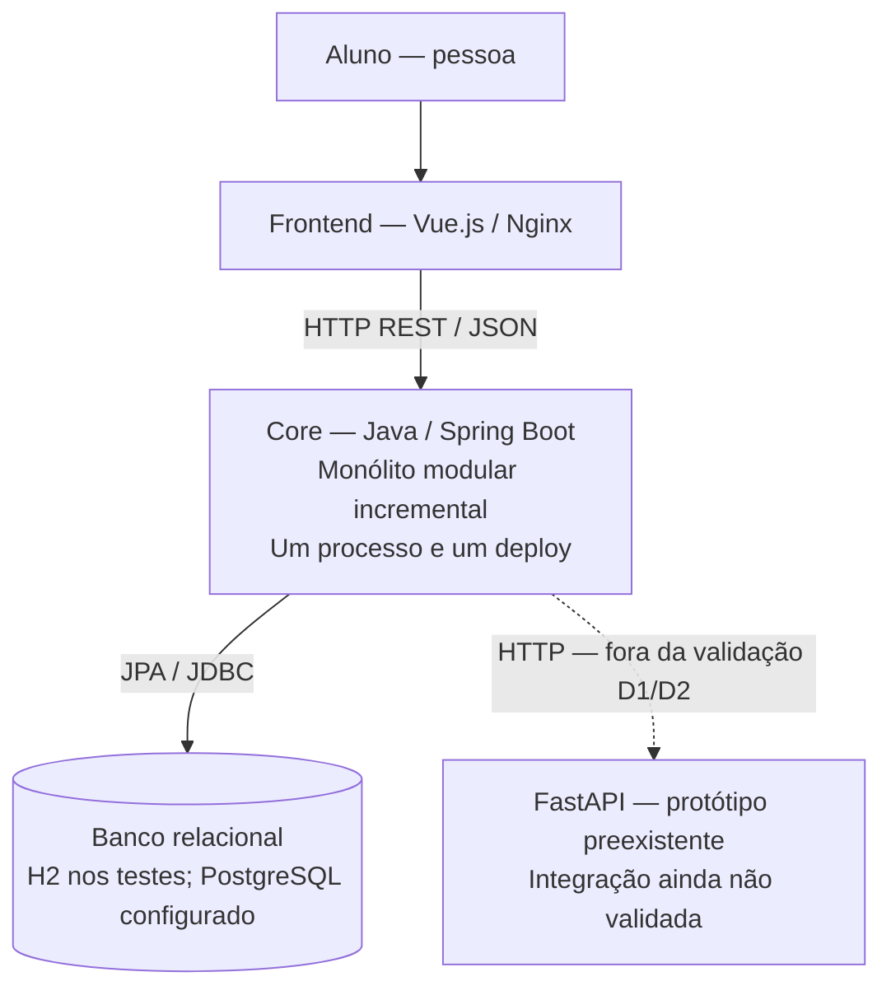
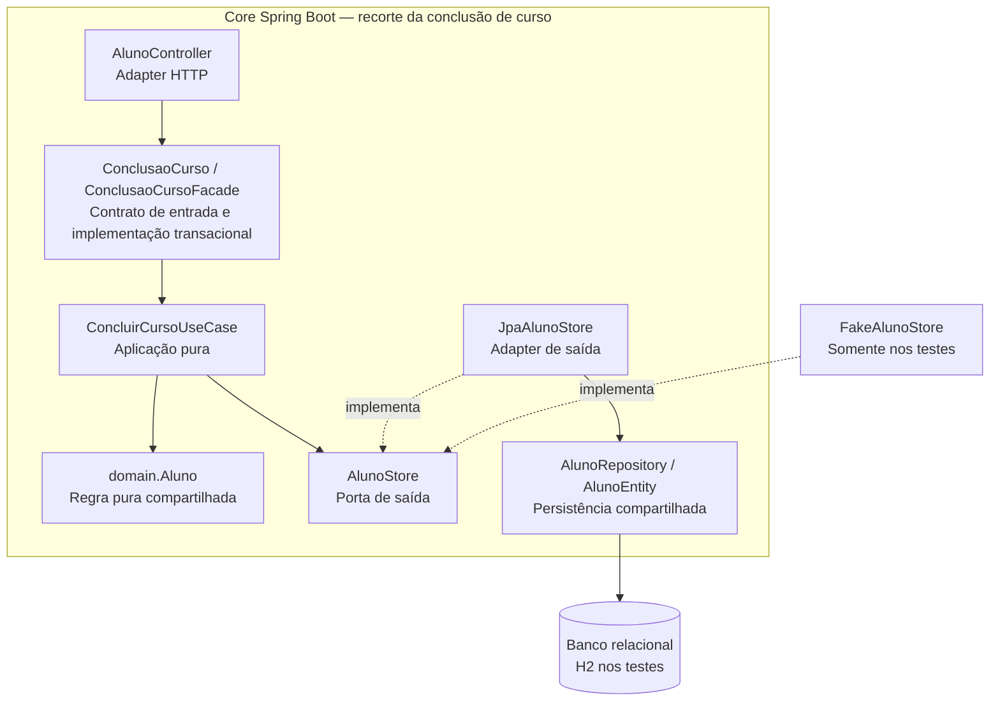

# Architecture Lab B1 — Educação Continuada Gamificada

Evolução incremental do MVP da AC1 em Java/Spring Boot, Vue.js e banco relacional. Este README apresenta o conteúdo necessário para avaliar **os Desafios 1 e 2**, incluindo requisitos, decisões, diagramas e resultados reais. Os arquivos de apoio permitem conferir o detalhe das evidências.

**Repositório:** [MjDutil/DevOps-Project](https://github.com/MjDutil/DevOps-Project). **Integrantes registrados na AC1:** Felipe, Isadora e Maria Julia; identificação da equipe B1 ainda a confirmar. A equipe de **seis desenvolvedores** é uma premissa do cenário acadêmico, não a contagem dos integrantes identificados.

## Índice

- [Visão geral e critérios de leitura](#visao-geral)
- [Desafio 1 — Drivers e Evolução do Core](#desafio-1)
  - [Requisitos, ASRs e RPCs](#d1-requisitos)
  - [Alternativas e decisão — ADR-001](#d1-decisao)
  - [C4 Container](#d1-c4)
  - [Modularização e dependências antes/depois](#d1-modularizacao)
  - [Testes, evidências e rastreabilidade](#d1-evidencias)
- [Desafio 2 — Organização Interna do Core](#desafio-2)
  - [Requisitos, ASRs e RPCs](#d2-requisitos)
  - [Alternativas e decisão — ADR-002](#d2-decisao)
  - [Responsabilidades, portas e adapters](#d2-responsabilidades)
  - [C4 Component](#d2-c4)
  - [Testes, evidências e rastreabilidade](#d2-evidencias)
- [Execução e validação](#execucao)
- [Histórico AC1 e funcionalidades preservadas](#historico-ac1)
- [Pendências e publicação](#pendencias)

<a name="visao-geral"></a>
## Visão geral e critérios de leitura

| Desafio | Decisão implementada | Evidência principal |
|---|---|---|
| 1 — Evolução do Core | Monólito modular incremental na conclusão de curso | Fronteira pública, dependências antes/depois e 25 testes na entrega D1 |
| 2 — Organização interna | Ports & Adapters na mesma funcionalidade | Contrato comum fake/JPA, núcleo executado somente com JDK e suíte final de 51 testes |

**Escopo comprovado:** conclusão de curso, recompensa por fórum e evolução para Premium. O protótipo FastAPI já estava no pacote inicial; sua integração não foi validada nestes desafios. Desafios 3–6 continuam pendentes.

**Limites:** ranking e badges não foram implementados; não há teste de carga nem comprovação de suporte a 100.000 usuários. H2 foi exercitado automaticamente; PostgreSQL/Docker, navegador e transporte HTTP real não foram validados nesta etapa. Os testes HTTP usam DispatcherServlet/MockMvc com serviços e persistência reais, sem servidor em porta de rede.

O padrão de leitura em cada desafio é **RF → RNF → ASR + RPC → alternativas → ADR → C4 → evidência**. O [registro cumulativo obrigatório](docs/arquitetura/README.md) continua mantido, com a matriz dos seis desafios.

---

<a name="desafio-1"></a>
## Desafio 1 — Drivers e Evolução do Core

### Contexto do problema

O case prevê a evolução de aproximadamente **1.000 para até 100.000 usuários**, com crescimento do ranking diferente das demais capacidades. A decisão é como organizar o Core sem introduzir uma arquitetura distribuída antes de haver necessidade comprovada.

No código da AC1 existem conclusão de curso, bônus por participação no fórum e Premium. O enunciado permite modularizar uma funcionalidade existente; selecionamos **conclusão de curso**, sem criar ranking apenas para demonstrar a arquitetura. O cenário de crescimento é um driver de planejamento, não um resultado de desempenho deste repositório.

<a name="d1-requisitos"></a>
### Requisitos funcionais e não funcionais

| RF | Necessidade | Situação no projeto |
|---|---|---|
| RF01 — Ranking | Evoluir uma capacidade com crescimento de carga potencialmente distinto | Driver futuro; não implementado neste mini-lab |
| RF02 — Conquistas/gamificação | Recompensar a conclusão e preservar as regras existentes | Média **estritamente maior que 7** libera três cursos; fórum e Premium preservados |

| RNF | FURPS+ | Papel na decisão |
|---|---|---|
| Manutenibilidade | Supportability | Delimitar mudanças por capacidade |
| Escalabilidade | Performance | Preparar fronteiras para avaliar extração futura |
| Complexidade operacional | Restrição operacional (+) | Manter operação proporcional à equipe |
| Testabilidade | Supportability | Verificar preservação funcional; não determina sozinha a decomposição macro |
| Desempenho | Performance | Requer medições antes de justificar um serviço separado |

**Três ASRs prioritários:**

| ASR | Justificativa arquitetural |
|---|---|
| Manutenibilidade | Uma API pública para a capacidade evita que seus clientes conheçam casos de uso e persistência internos. |
| Escalabilidade | Uma fronteira explícita permite avaliar extração seletiva quando houver necessidade medida de escala ou deploy independente. |
| Complexidade operacional | Um processo e um deploy do Core evitam adicionar rede, contratos remotos e operação distribuída à equipe de seis. |

**RPCs:** Core permanece em **Java/Spring Boot**; equipe de **seis desenvolvedores** no case; **JPA e banco relacional** existentes; **legado da AC1** e evolução incremental, sem reescrita integral.

<a name="d1-decisao"></a>
### Alternativas, decisão e resumo do ADR-001

| Alternativa | Benefícios | Custos e trade-offs | Avaliação |
|---|---|---|---|
| A — Monólito em camadas | Um deploy, estrutura conhecida e menor esforço imediato | Organização técnica mistura capacidades nos serviços e torna menos explícitas suas fronteiras | Viável para continuidade, menos preparado para a evolução prevista |
| B — Monólito modular | Contratos por capacidade, chamadas locais e possibilidade de evolução seletiva | Mais interfaces e mapeamentos; processo, deploy, banco e falhas ainda compartilhados | **Escolhida** |
| C — Decomposição seletiva em serviços | Escala e deploy independentes da capacidade extraída | Rede, consistência de dados, tolerância a falhas, observabilidade e operação adicionais | Adiada até existir evidência que justifique esses custos |

**Decisão:** adotar **monólito modular incremental**, começando pela conclusão de curso. O equilíbrio favorece manutenibilidade e preparação para evolução sem aumentar prematuramente a complexidade operacional.

**Resumo do ADR-001:** o Core continua uma aplicação Spring Boot, com contrato público para a funcionalidade selecionada. `AlunoService` deixa de conhecer seu caso de uso interno. Reavaliar extração do ranking somente quando métricas ou uma necessidade concreta de deploy independente justificarem a distribuição. Consulte o [ADR-001 completo](docs/adr/ADR-001.md).

**Consequências positivas:** fronteira explícita, menor dependência do serviço legado em relação ao interior do módulo e transação delimitada na entrada da capacidade.

**Limitações e trade-offs:** modularização parcial; domínio, entidade, repository e banco ainda compartilhados; mais contrato e mapeamento; fronteiras por convenção de pacotes, sem isolamento Maven/JPMS. Nenhum ganho de latência, throughput ou capacidade foi demonstrado. A transação do D1 não foi apresentada como solução geral para concorrência; o D2 aperfeiçoa a atualização por snapshot.

<a name="d1-c4"></a>
### C4 Container — um único Core



[Versão SVG renderizada e versionada](docs/evidencias/revisao-readme/c4-container.svg).

A capacidade de conclusão fica **dentro do Core**, sem processo, deploy, comunicação de rede ou banco exclusivos. O diagrama mostra containers lógicos; os módulos internos não são representados como microserviços. A seta tracejada identifica o protótipo herdado, não uma entrega comprovada de IA.

<a name="d1-modularizacao"></a>
### Modularização e comparação das dependências

É necessário distinguir a origem AC1 do pacote B1 recebido: a primeira extração de caso de uso e porta já existia antes desta etapa e não foi atribuída à implementação do D1.

| Estado | Dependências da conclusão de curso |
|---|---|
| AC1 original, commit `153cdfb` | `AlunoController → AlunoService → AlunoRepository / AlunoEntity`; regra de média duplicada no serviço e domínio |
| Pacote B1 local recebido | `AlunoController → AlunoService → ConcluirCursoUseCase → AlunoStore ← JpaAlunoStore`; regra já usa domínio puro |
| Entrega D1, commit `8bf8785` | `AlunoController → ConclusaoCurso ← ConclusaoCursoFacade → ConcluirCursoUseCase → AlunoStore ← JpaAlunoStore` |

```text
gamificacao/
├── api/ConclusaoCurso.java              contrato público e resultado próprio
├── application/
│   ├── ConcluirCursoUseCase.java        orquestração pura
│   ├── AlunoStore.java                  porta de persistência
│   └── AlunoSnapshot.java               dados sem JPA
└── infrastructure/
    ├── ConclusaoCursoFacade.java        entrada transacional
    ├── GamificacaoConfiguration.java    composição Spring
    └── JpaAlunoStore.java               persistência real
```

O controller depende somente da API pública do módulo e mantém o JSON anterior. `AlunoService` continua cuidando da criação de aluno, fórum e Premium. Foi eliminada a dependência desse serviço para `gamificacao.application`; o adapter ainda utiliza o repository compartilhado e a aplicação ainda utiliza `domain.Aluno` compartilhado.

<a name="d1-evidencias"></a>
### Resultados reais, evidências e rastreabilidade

| Validação do D1 | Resultado observado |
|---|---|
| Suíte recebida | 15 testes passaram |
| Nova regressão HTTP/JPA executada contra os fontes anteriores | Oito cenários passaram |
| `mvn verify` após modularização | **25 testes**, zero falhas/erros/ignorados; **BUILD SUCCESS** |
| Reconfirmação antes do D2 | Os mesmos 25 testes passaram novamente |

Composição dos 25 testes: 11 do domínio, cinco do caso de uso com fake, oito HTTP/JPA/H2 e um de inicialização Spring. As integrações verificam médias 8/7/6,5, fórum combinado com conclusão, limiar Premium, voucher, moedas e preservação dos dados após nova conclusão. A tentativa inicial offline falhou no empacotamento por dependências ausentes; o `verify` posterior concluiu com sucesso, conforme logs.

| Evidência verificável | Arquivo |
|---|---|
| Registro completo e limites | [Evidências D1](docs/evidencias/desafio-1/README.md) |
| Clone original × arquivos locais | [Comparação](docs/evidencias/desafio-1/comparacao-clone-local.txt) |
| Dependências antes / depois | [Antes](docs/evidencias/desafio-1/dependencias-antes.txt) · [Depois](docs/evidencias/desafio-1/dependencias-depois.txt) |
| Alterações reais de produção | [Diff D1](docs/evidencias/desafio-1/refatoracao-d1.diff) |
| Regressão contra os fontes anteriores | [Log dos oito cenários](docs/evidencias/desafio-1/testes-integracao-antes.txt) |
| Build e testes da entrega D1 | [Verify](docs/evidencias/desafio-1/verify-com-rede.txt) · [Reconfirmação pré-D2](docs/evidencias/desafio-1/verify-confirmacao-pre-d2.txt) |

**Rastreabilidade D1:** RF02 exercitado + RF01 futuro → RNFs analisados → manutenibilidade, escalabilidade e complexidade operacional + RPCs Java/Spring, seis desenvolvedores, banco relacional e legado → camadas × modular × serviços → ADR-001 → C4 Container acima → comparação e testes vinculados nesta seção.

---

<a name="desafio-2"></a>
## Desafio 2 — Organização Interna do Core

### Contexto e problema de acoplamento

As regras de gamificação precisam evoluir sem conhecer banco, framework ou integrações. Na AC1, o serviço misturava orquestração e persistência. O estado real anterior ao D2 já era parcialmente hexagonal: havia domínio puro, porta, fake e fachada transacional.

O D2 consolida esse isolamento na conclusão de curso e comprova que **a mesma regra e o mesmo caso de uso funcionam com adapters diferentes**, sem reescrever as demais capacidades.

<a name="d2-requisitos"></a>
### Requisitos, ASRs e RPCs

**RF02:** aplicar a recompensa de conclusão e preservar fórum/Premium. RF01 permanece futuro. Os RNFs de **testabilidade, modificabilidade e manutenibilidade** pertencem a Supportability no FURPS+. Consistência da atualização persistida, relacionada a Reliability, é verificada como correção funcional, sem acrescentar um quarto ASR.

| ASR prioritário | Justificativa arquitetural |
|---|---|
| Testabilidade | Compilar e executar domínio/aplicação somente com JDK e usar um fake permite testar sem inicializar Spring ou acessar banco. |
| Modificabilidade | A aplicação depende de `AlunoStore`, não de JPA; substituir o adapter preserva a regra central. |
| Manutenibilidade | A regra permanece em `domain.Aluno`; SQL, mapeamentos e transações ficam na infraestrutura. |

**RPCs:** manter Core Spring Boot, reaproveitar as regras existentes, preservar endpoints e JPA/banco relacional e evoluir uma fatia sem reescrever o produto inteiro. O fake é uma implementação de teste, não uma nova persistência de produção.

<a name="d2-decisao"></a>
### Alternativas, decisão e resumo do ADR-002

| Alternativa | Benefícios | Custos e limitações |
|---|---|---|
| A — Manter o estado D1, com camadas legadas e fatia parcialmente hexagonal | Menor esforço; domínio puro e transação já delimitada | Porta `salvar` genérica, fake restrito ao unitário e ausência de contrato comum comprovado entre adapters |
| B — Consolidar Ports & Adapters incremental | Contrato explícito, mesma regra com fake/JPA e validação independente do framework | Mais interface, mapeamento e testes de integração; demais capacidades continuam legadas |
| C — Migrar todo o produto para Clean/Onion/DDD | Padronização ampla de fronteiras | Custo e risco desproporcionais ao exercício; altera funcionalidades não relacionadas |

**Decisão:** B. Em comparação com a arquitetura em camadas original, a dependência é invertida: a aplicação define a porta e a infraestrutura a implementa. Em relação ao D1, a mudança consolida um isolamento já iniciado e adiciona prova de contrato e consistência. Hexagonal, Clean, Onion e DDD podem combinar princípios; não exigem migração global.

**Resumo do ADR-002:** preservar o domínio, explicitar a porta de atualização de cursos, validar fake/JPA com os mesmos cenários e manter a transação na infraestrutura. Consulte o [ADR-002 completo](docs/adr/ADR-002.md).

**Consequências:** regra verificável sem Spring/banco, persistência substituível e escrita limitada ao campo necessário. O custo é manter contrato, mapeamentos e integração real do adapter. Domínio/entidade/repository/banco permanecem compartilhados; fronteiras são de pacote, não módulos Maven/JPMS.

<a name="d2-responsabilidades"></a>
### Responsabilidades das classes e interfaces

| Elemento | Responsabilidade | Dependências relevantes |
|---|---|---|
| `domain.Aluno` | Regra `media > 7 → +3 cursos`; arquivo preservado integralmente | Somente JDK |
| `ConclusaoCurso` | Contrato público de entrada e resultado sem infraestrutura | Somente JDK |
| `ConcluirCursoUseCase` | Buscar snapshot, executar regra e solicitar atualização | Domínio e `AlunoStore` |
| `AlunoStore` | Porta de saída: buscar e atualizar cursos se o snapshot esperado ainda corresponder | Somente JDK |
| `AlunoSnapshot` | Dados da fronteira de persistência, sem entidade JPA | Somente JDK |
| `FakeAlunoStore` | Implementar a porta em memória para testes | JDK e contrato; somente em `src/test` |
| `JpaAlunoStore` | Implementar a porta usando persistência real | Spring, repository e entidade |
| `ConclusaoCursoFacade` | Implementar a entrada pública e delimitar a transação completa | Spring e caso de uso |
| `GamificacaoConfiguration` | Construir o caso de uso com a porta injetada | Spring seleciona o adapter JPA na composição real |
| `AlunoRepository` | Consultas JPA e UPDATE parcial condicional | Spring Data JPA e `AlunoEntity` |
| `AlunoController` / DTOs | Traduzir HTTP/JSON para o contrato público e vice-versa | Spring Web; fora da regra de domínio |

### Comparação dos adapters e consistência

| Aspecto | Fake/in-memory | JPA/H2 |
|---|---|---|
| Contrato implementado | `AlunoStore` | O mesmo `AlunoStore` |
| Armazenamento | Map em memória | Tabela `alunos`, via JPA |
| Spring/banco necessários | Não | Sim |
| Regra central | `ConcluirCursoUseCase` + `domain.Aluno` | Exatamente os mesmos |
| Atualização | Confere snapshot e altera somente cursos | UPDATE parcial com pré-condições de ID, média e saldo |
| Snapshot obsoleto/ausente | `ConcurrentModificationException` | A mesma exceção quando nenhuma linha corresponde |
| Transação | Não simula transações de banco | Fachada transacional, commit/rollback reais em H2 |
| Cenários comuns comprovados | 11 | Os mesmos 11, mais três verificações transacionais |

A troca é feita pelo construtor `new ConcluirCursoUseCase(adapter)`. O algoritmo de `domain.Aluno` não foi alterado; a [comparação SHA-256](docs/evidencias/desafio-2/dominio-preservado.txt) registra isso.

A porta passou de `salvar(snapshot)` para `atualizarCursos(snapshotEsperado, novoSaldo)`. O adapter JPA elimina a segunda busca no código e escreve somente cursos, preservando média, plano, voucher e moedas. Duas chamadas anteriores a `findById` não provavam dois SELECTs, devido ao cache JPA; portanto, não afirmamos redução de consultas em relação ao baseline.

A fachada mantém `@Transactional`; a escrita do adapter exige transação existente com `MANDATORY`. Uma pré-condição não atendida rejeita a atualização, sem sobrescrever o estado mais recente. **Limites:** não há retry automático, versionamento global ou mapeamento HTTP específico de conflitos. Os testes usam snapshots obsoletos de forma determinística, sem prova multithread/carga; escritas legadas de fórum/Premium podem exigir controle próprio.

<a name="d2-c4"></a>
### C4 Component — interior do Core



[Versão SVG renderizada e versionada](docs/evidencias/revisao-readme/c4-component.svg).

O diagrama recorta a capacidade selecionada. `ConclusaoCurso` e sua implementação transacional estão agrupadas como entrada da capacidade; as responsabilidades individuais estão na tabela acima. As setas contínuas indicam dependências de uso e as tracejadas **implementa** indicam inversão pela porta. A aplicação não conhece o adapter concreto. O fake fica fora da composição de produção; não é container ou serviço implantado. Criação, fórum e Premium continuam no serviço legado, compartilhando domínio e persistência; a [visão detalhada](docs/arquitetura/diagramas.md) também os apresenta.

<a name="d2-evidencias"></a>
### Resultados reais, evidências e rastreabilidade

| Classe / grupo | Testes | O que comprova |
|---|---|---|
| `AlunoTest` | 11 | Regras de domínio existentes |
| `ConcluirCursoUseCaseTest` | 5 | Caso de uso com fake sem contexto Spring |
| `AlunoHttpJpaIntegrationTest` | 8 | Regressões D1 por HTTP simulado, beans reais e JPA/H2 |
| `TddApplicationTests` | 1 | Inicialização do contexto |
| `FakeAlunoStoreContractTest` | 11 | Contrato da porta com adapter em memória |
| `JpaAlunoStoreContractTest` | 14 | Os mesmos 11 cenários + commit, rollback e exigência de transação |
| `DominioIsoladoTest` | 1 | Compilação sem bibliotecas externas e execução em novo processo Java |
| **Total final D1 + D2** | **51** | **Zero falhas, erros ou testes ignorados; BUILD SUCCESS** |

Os 11 cenários comuns verificam busca existente/ausente, médias 8/7/6,5, acumulação de quatro conclusões, erro do caso de uso para aluno ausente, preservação de ID/média, rejeição de saldo ou média obsoletos e atualização sem criação de aluno inexistente.

No cenário H2 medido, a conclusão carregou **uma entidade e preparou dois statements: SELECT + UPDATE**. Consultas JDBC posteriores verificaram commit e rollback. Isso não é benchmark. A compilação isolada e o `jdeps` confirmaram que o bytecode do núcleo depende somente de **`java.base`**. O JAR e o relatório JaCoCo foram gerados; não foi definida meta nem afirmada cobertura integral.

| Evidência verificável | Arquivo |
|---|---|
| Registro completo | [Evidências D2](docs/evidencias/desafio-2/README.md) |
| Suíte completa e relatórios | [Verify D2](docs/evidencias/desafio-2/mvn-verify.txt) · [Resumo](docs/evidencias/desafio-2/resumo-testes.txt) |
| Mesmos cenários com os dois adapters | [Contrato comum](src/test/java/org/example/tdd/gamificacao/AlunoStoreContract.java) · [Fake](src/test/java/org/example/tdd/gamificacao/FakeAlunoStoreContractTest.java) · [JPA/H2](src/test/java/org/example/tdd/gamificacao/JpaAlunoStoreContractTest.java) |
| Execução sem infraestrutura e dependências | [Resultado JDK/jdeps](docs/evidencias/desafio-2/nucleo-isolado.txt) · [Script reproduzível](docs/evidencias/desafio-2/verificar-nucleo.sh) |
| Preservação da regra e revisão de código | [SHA-256 do domínio](docs/evidencias/desafio-2/dominio-preservado.txt) · [Diff D2](docs/evidencias/desafio-2/mudancas-producao.diff) |
| Revalidação para esta revisão do README | [Novo `mvn verify`](docs/evidencias/revisao-readme/mvn-verify.txt) · [Validação editorial e diagramas](docs/evidencias/revisao-readme/README.md) |

**Rastreabilidade D2:** RF02 → testabilidade, modificabilidade e manutenibilidade → três ASRs + RPCs Spring Boot, regras reaproveitadas, banco existente e evolução incremental → estado D1 parcial × Ports & Adapters × migração global → ADR-002 → C4 Component acima → contrato comum, execução JDK isolada e integrações vinculadas.

---

<a name="execucao"></a>
## Execução e validação

Pré-requisitos usados nos registros: **JDK 17** e **Maven 3.9.11**. Execute na raiz do projeto:

```bash
# Suíte completa, empacotamento Spring Boot e relatório JaCoCo
mvn verify

# Contrato compartilhado dos adapters
mvn -Dtest=FakeAlunoStoreContractTest,JpaAlunoStoreContractTest test

# Compilar, executar e inspecionar dependências sem Spring/JPA/banco
sh docs/evidencias/desafio-2/verificar-nucleo.sh

# Inspeção adicional dos imports do módulo
python3 docs/evidencias/desafio-1/verificar-fronteiras.py
```

Relatórios locais: `target/surefire-reports/`, JAR em `target/TDD-0.0.1-SNAPSHOT.jar` e cobertura em `target/site/jacoco/index.html`. Esses arquivos gerados não são versionados; os logs textuais das execuções estão nas evidências.

```bash
# Backend local, com H2 por padrão
mvn spring-boot:run

# Frontend, em outro terminal
cd frontend
npm ci
npm run dev
```

Frontend: `http://localhost:5173`; API: `http://localhost:8080`; Swagger: `http://localhost:8080/swagger-ui/index.html`. São endereços locais esperados, não links públicos de evidência. O [Maven Wrapper](.mvn/wrapper/maven-wrapper.properties) também está disponível, mas as execuções registradas utilizaram o Maven instalado.

O [Compose](docker-compose.yml) configura PostgreSQL, PgAdmin, Core, frontend e o protótipo IA preexistente. Sua presença não comprova execução; integração PostgreSQL/Docker e IA permanecem pendentes nestes desafios.

<a name="historico-ac1"></a>
## Histórico AC1 e funcionalidades preservadas

| História | Regra preservada | Evidência original |
|---|---|---|
| US1 — Desempenho acadêmico | Média > 7 libera três cursos; igual ou abaixo não libera | [US1 RED](evidencias/US1-RED.png) · [US1 BLUE](evidencias/US1-BLUE.png) |
| US2 — Participação no fórum | Mais tópicos que os demais e ao menos um comentário de ajuda libera um curso | [US2 GREEN](evidencias/US2-GREEN.png) · [Endpoint](evidencias/US2-ENDPOINT-RECOMPENSA-FORUM.PNG) |
| US3 — Premium | A partir de 12 cursos: Premium, voucher e três moedas | [US3 GREEN](evidencias/US3-GREEN.PNG) · [Endpoint](evidencias/US3-ENDPOINT-PREMIUM.PNG) |

Endpoints preservados: `POST /alunos`, `POST /alunos/{id}/concluir-curso`, `POST /alunos/{id}/recompensar-forum` e `POST /alunos/{id}/verificar-premium`. Exemplos em [requests.http](requests.http).

O [README histórico da AC1](docs/ac1/README.md) preserva histórias, BDD, imagens TDD/ATDD, instruções e checklist da entrega original. As imagens antigas são evidências históricas, não resultados novos do B1.

<a name="pendencias"></a>
## Pendências e publicação

- Confirmar a identificação dos integrantes B1.
- Validar PostgreSQL/Docker, navegador e transporte HTTP real, se exigidos na etapa seguinte.
- Avaliar tratamento de entradas inválidas/conflitos HTTP e concorrência dos fluxos legados; não há retry automático ou controle global implementado.
- Executar os Desafios 3–6 antes de apresentá-los como concluídos.
- Publicar a entrega na branch padrão **`main`**, após aprovação do responsável. Até essa integração, o README público ainda mostra a entrega anterior.

Histórico local: limpeza `a25b2b2`, D1 `8bf8785` e D2 `34206c7`. A revisão do README é registrada em commit separado. A [preparação da integração](docs/evidencias/revisao-readme/integracao.md) documenta o estado remoto consultado, a comparação e o procedimento proposto. **Merge e push na branch padrão aguardam aprovação.**
