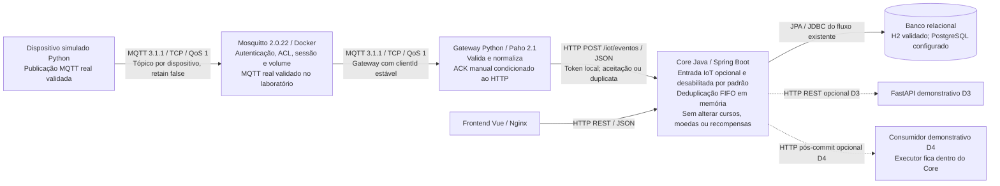

# Architecture Lab B1 — Educação Continuada Gamificada

Evolução arquitetural de uma plataforma de educação, com decisões justificadas e evidências técnicas para avaliação acadêmica.

[Sobre](#sobre-o-projeto) · [Tecnologias](#tecnologias-utilizadas) · [Arquitetura](#arquitetura) · [Desafios](#desafios) · [Execução](#como-executar-e-testar) · [Documentação e equipe](#documentação-e-equipe)

## Sobre o projeto

Na **AC1**, construímos um MVP de gamificação em Java/Spring Boot e Vue.js. O **B1 — Architecture Lab** evolui esse mesmo produto em seis desafios, analisando como organizar o Core, integrar serviços e preparar sua operação sem reescrever as regras existentes.

**Funcionalidades implementadas:** média acima de 7 libera três cursos; participação elegível no fórum libera um curso; a partir de 12 cursos, o aluno recebe Premium, voucher e três moedas.

**Integração demonstrativa:** o Core consulta recomendação e assistente em uma API Python. O D3 validou comunicação, fallback, timeout de leitura e recuperação; as respostas são demonstrativas, sem ML, RAG ou LLM reais.

O D4 acrescenta **notificação HTTP demonstrativa após commit**, assíncrona em memória, com modo síncrono para comparação. Fica desabilitada por padrão e não oferece entrega durável. Ranking, badges e email real ainda não estão implementados. A entrada IoT demonstrativa é opcional e não altera recompensas; o caminho MQTT → gateway → Core foi validado com broker real. **D1–D5 estão implementados/validados no escopo dos mini-labs; D6 permanece pendente.**

## Tecnologias utilizadas

| Situação | Tecnologias e uso |
|---|---|
| Implementadas no Core | Java 17, Spring Boot, Spring Data JPA e API REST. H2 utilizado nas validações automáticas. |
| Presentes na interface | Vue.js, Vite e Axios. Interface herdada da AC1; navegador não validado nesta etapa B1. |
| Integração demonstrativa validada | Python, FastAPI e Uvicorn, consumidos pelo Core por HTTP/JSON. |
| Testes e build utilizados | Maven, JUnit, Mockito, MockMvc e JaCoCo. |
| Configuradas, sem execução validada nesta etapa | Docker Compose, PostgreSQL, PgAdmin e Nginx. |
| Comunicação demonstrativa D4 | Executor em memória no Core e consumidor HTTP Python padrão; sem broker e sem persistência de eventos. |
| D5 demonstrativo validado | Python/Paho, MQTT 3.1.1/QoS 1 e Mosquitto em Docker. Autenticação, ACL, sessão e encaminhamento HTTP exercitados. |
| Planejadas para D6/evolução | Jenkins, Prometheus e Grafana. Nenhuma mensageria interna adicional no D5. |

## Arquitetura

O Core é um **monólito modular incremental**. Na conclusão de curso, uma API pública delimita a capacidade e **Ports & Adapters** mantém a regra de domínio independente de Spring e JPA. O serviço Python tem processo próprio e é opcional: sua indisponibilidade não impede as operações essenciais testadas do Core. No D4, o envio de notificações também é opcional e ocorre somente após commit; fila cheia ou falha HTTP não desfazem a conclusão.



Consulte o [C4 completo](docs/arquitetura/diagramas.md), a [fonte Mermaid atual](docs/evidencias/desafio-5/c4-container.mmd) e o [registro das decisões](docs/arquitetura/README.md). O caminho IoT/MQTT foi exercitado no laboratório real; não utiliza o executor D4 como broker. A modularização é parcial; domínio e persistência ainda são compartilhados com fluxos legados.

## Desafios

| Desafio e objetivo | Decisão | Estado real | Documentação e evidências |
|---|---|---|---|
| **D1 — Evolução do Core:** delimitar uma capacidade existente | Monólito modular na conclusão de curso | Implementado; comparação antes/depois e 25 testes na entrega D1 | [ADR-001](docs/adr/ADR-001.md) · [C4 Container](docs/arquitetura/diagramas.md#c4-container--estado-do-desafio-1) · [Evidências](docs/evidencias/desafio-1/README.md) |
| **D2 — Organização interna:** proteger as regras das tecnologias | Ports & Adapters, com contrato comum fake/JPA | Implementado; núcleo isolado e 51 testes na entrega D2 | [ADR-002](docs/adr/ADR-002.md) · [C4 Component](docs/arquitetura/diagramas.md#c4-component--core-estado-do-desafio-2) · [Evidências](docs/evidencias/desafio-2/README.md) |
| **D3 — Serviço Python e IA:** definir fronteira e tratar falhas | FastAPI independente, com timeout e fallback | Mini-lab validado; 18 verificações HTTP reais; sem modelos de IA | [ADR-003](docs/adr/ADR-003.md) · [C4 Container](docs/arquitetura/diagramas.md#c4-container--estado-validado-do-desafio-3) · [Evidências](docs/evidencias/desafio-3/README.md) |
| **D4 — Comunicação e eventos:** preservar conclusão com consumidor indisponível | Notificação pós-commit, assíncrona em memória; REST síncrono para comparação | Mini-lab validado; 25 verificações HTTP reais; sem entrega durável | [ADR-004](docs/adr/ADR-004.md) · [C4 e sequência](docs/arquitetura/diagramas.md#c4-container--desafio-4) · [Evidências](docs/evidencias/desafio-4/README.md) |
| **D5 — IoT e MQTT:** receber eventos de dispositivos | MQTT 3.1.1/QoS 1, gateway e recepção HTTP opcional; sem recompensas | Mini-lab validado; 15 cenários MQTT reais aprovados, sem garantia de exatamente uma vez | [ADR-005](docs/adr/ADR-005.md) · [C4 e fluxo](docs/arquitetura/diagramas.md#c4-container--desafio-5) · [Evidências](docs/evidencias/desafio-5/README.md) |
| **D6 — CI/CD e observabilidade:** construir, entregar e observar | Proposta: Jenkins e métricas Prometheus/Grafana | Pendente; pipeline e monitoramento ainda não implementados | [ADR-006 proposto](docs/adr/ADR-006.md) · [Deployment proposto](docs/arquitetura/diagramas.md#c4-deployment--visão-proposta-para-desafio-6) · [Evidência prevista e pendente](docs/adr/ADR-006.md) |

A fundamentação de cada desafio segue **RF → RNF → ASR → RPC → alternativas → ADR → C4 → evidência** no [registro arquitetural cumulativo](docs/arquitetura/README.md), com até três ASRs por desafio.

## Como executar e testar

Pré-requisitos: **JDK 17 e Maven** (3.9.11 nas execuções registradas). Para a interface, Node.js compatível com Vite 7 e npm; para o laboratório IA, Python com ambiente virtual, conforme o [roteiro FastAPI](labs/ia/README.md).

No Terminal do macOS, entre na pasta do projeto; ajuste o caminho se necessário:

```bash
cd ~/Downloads/DevOps-Project-B1
java -version
mvn -version
mvn clean verify
```

A última execução aprovou **96 testes Maven**, sem falhas, erros ou ignorados. JaCoCo Maven: 98.13% de instruções, 92.31% de branches e 98.77% de linhas. No D5, passaram **14 testes Python sem broker e 12 checks HTTP reais**, além das regressões de 25 checks D4 e 18 D3. **15 cenários MQTT reais também passaram**: veja os [resultados D5](docs/evidencias/desafio-5/README.md). Os ensaios HTTP são contagens separadas do Surefire e não foram instrumentados para cobertura.

Para iniciar o backend com H2 em memória:

```bash
mvn spring-boot:run
```

Em outro terminal, para iniciar a interface:

```bash
cd ~/Downloads/DevOps-Project-B1/frontend
npm ci
npm run dev
```

Endereços esperados: interface `http://localhost:5173`, API `http://localhost:8080` e Swagger `http://localhost:8080/swagger-ui/index.html`. Exemplos dos endpoints de alunos estão em [requests.http](requests.http). O [Maven Wrapper](.mvn/wrapper/maven-wrapper.properties) está disponível; as evidências foram obtidas com Maven instalado.

Para executar o Python ou reproduzir interrupção, recuperação e timeout, siga o [laboratório integrado D3](docs/evidencias/desafio-3/README.md#reprodução). Para habilitar o laboratório de notificações e comparar os modos, siga o [roteiro D4](docs/evidencias/desafio-4/README.md#reprodução). Para IoT, consulte o [roteiro D5](labs/iot/README.md), com as etapas independentes e o ensaio MQTT real reproduzível. Relatórios Maven ficam em `target/surefire-reports/` e cobertura em `target/site/jacoco/index.html`.

**Limites da validação:** Docker foi utilizado para o Mosquitto; PostgreSQL/Compose principal e navegador não foram exercitados nesta etapa. Não há teste de carga, comprovação de 100.000 usuários ou controle global de concorrência. O timeout de leitura foi medido; o limite de conexão não foi medido em rede real. Esses resultados não representam uma validação completa de produção.

## Documentação e equipe

- [Registro arquitetural e matriz cumulativa de ASRs](docs/arquitetura/README.md)
- [Diagramas C4](docs/arquitetura/diagramas.md) e [ADRs](docs/adr/)
- [Evidências D1](docs/evidencias/desafio-1/README.md), [D2](docs/evidencias/desafio-2/README.md), [D3](docs/evidencias/desafio-3/README.md), [D4](docs/evidencias/desafio-4/README.md) e [D5](docs/evidencias/desafio-5/README.md)
- [Cobertura e resultados detalhados](docs/evidencias/cobertura/README.md)
- [Auditoria histórica D1/D2](docs/evidencias/auditoria-final/README.md)
- [Histórico AC1: histórias, BDD e evidências TDD/ATDD](docs/ac1/README.md)

**Equipe:** Felipe, Isadora e Maria Julia são os integrantes registrados na AC1. A identificação da equipe B1 ainda precisa de confirmação; a equipe de seis desenvolvedores é uma premissa do case acadêmico.

**Repositório:** [MjDutil/DevOps-Project](https://github.com/MjDutil/DevOps-Project). D4 consolidado no commit local `59cb7d1`, sem push. D5 está validado tecnicamente, mas ainda aguarda commit e publicação autorizados. D6 segue como continuidade.
