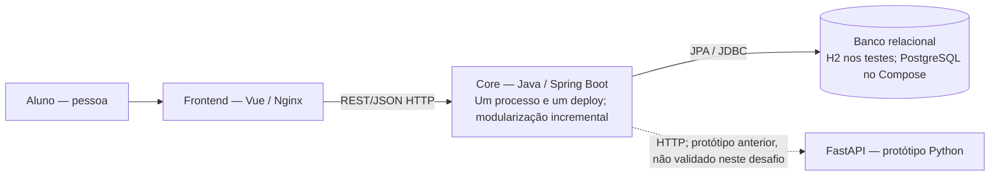
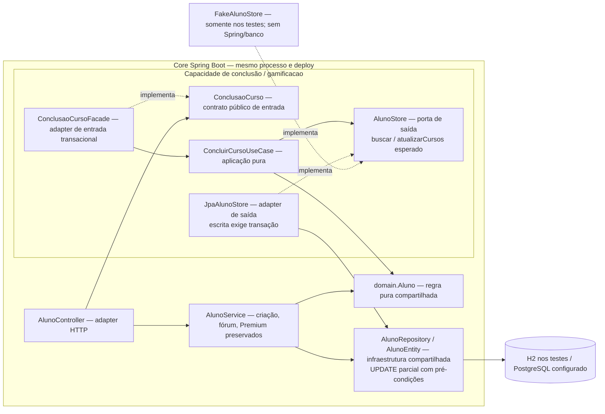
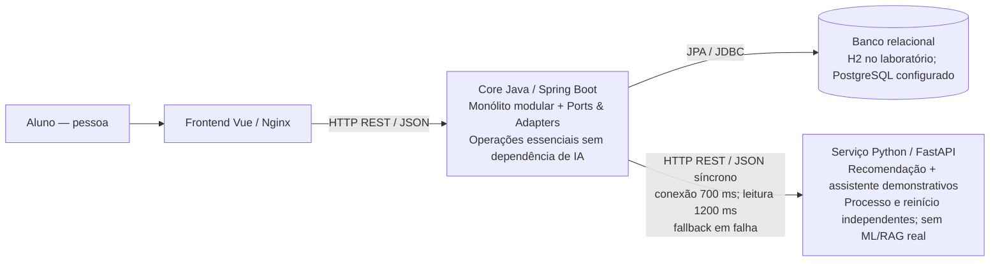
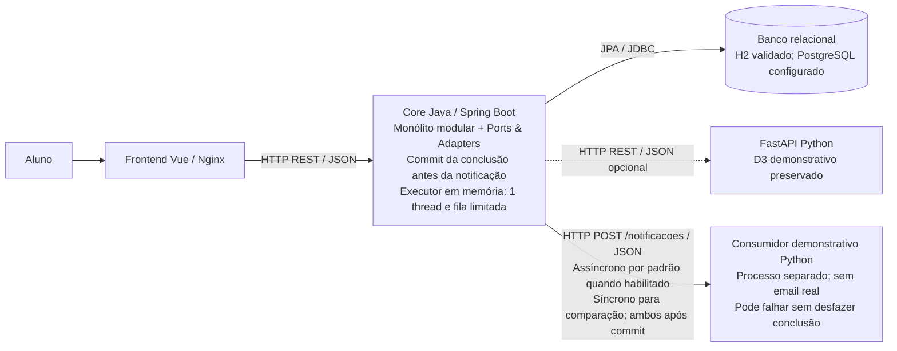
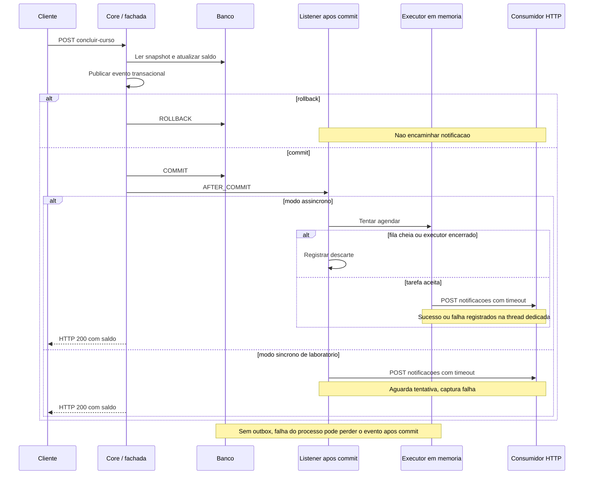
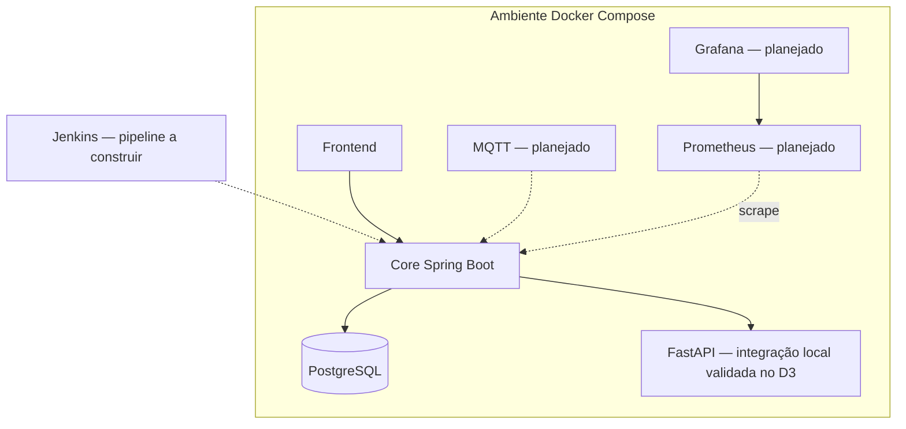

# Diagramas C4 — Architecture Lab B1

**Cuidado:** as visões abaixo descrevem a arquitetura **decidida/planejada**. O sistema atualmente entregue ainda é um MVP e não possui todos os componentes. O Core, frontend e banco existem; a integração FastAPI foi validada no D3 em rede local/H2. D4 acrescenta notificação demonstrativa pós-commit; D5/D6 continuam propostos.

## C4 Container — estado do Desafio 1

Conclusão de curso é uma capacidade interna do Core, sem deploy, rede ou banco exclusivos. A seta para FastAPI registra código herdado do pacote inicial; D1 não valida essa integração. Broker, IoT e observabilidade permanecem apenas na visão futura abaixo.

## C4 Component — Core, estado do Desafio 2

Setas contínuas representam dependências de uso; “implementa” explicita inversão de dependências. O caso de uso depende da porta; os adapters implementam a porta definida pela aplicação. O fake não é bean nem serviço/container de produção. Na composição real, `GamificacaoConfiguration` injeta `AlunoStore` no caso de uso e o Spring seleciona o adapter JPA.

A chamada pública entra pela fachada transacional; o contrato de saída atualiza somente cursos, rejeitando snapshot obsoleto. Domínio, entidade e repository seguem compartilhados com o legado, sem migração global. A mesma regra foi exercitada com os dois adapters nos [testes D2](../evidencias/desafio-2/README.md). O nível Container continua inalterado: uma aplicação Core, sem novos serviços.

## C4 Container — estado validado do Desafio 3

O D3 validou Core → FastAPI e Core → H2 em processos locais, incluindo falha, recuperação e timeout de leitura. Frontend/navegador e PostgreSQL/Compose não foram exercitados. Não há acesso do Python ao banco do Core; a recomendação usa somente o ID no contrato demonstrativo. Falha da IA degrada apenas a resposta opcional; conclusão, fórum e Premium continuam locais ao Core. Esta visão evolui o Container D1 sem alterar o Component D2. [Logs, respostas e tempos](../evidencias/desafio-3/README.md).

## C4 Container — Desafio 4

Notificações são desabilitadas por padrão. Quando habilitadas, o listener após commit usa executor de uma thread e fila limitada dentro do Core; não é um serviço ou broker adicional. O modo síncrono existe somente para comparação. Consumidor Python demonstrativo é processo separado; não é o serviço FastAPI do D3. Frontend/PostgreSQL são componentes existentes/configurados, sem nova validação de navegador/Docker. [Fonte e SVG](../evidencias/desafio-4/README.md).

### Sequência da conclusão e notificação

A tentativa em segundo plano pode iniciar antes ou depois da resposta HTTP, mas somente após commit. Não se garante ordem global nem persistência da fila. Rollback e snapshot obsoleto não encaminham evento de sucesso; falhas HTTP e saturação são registradas sem transformar a conclusão confirmada em erro.

## C4 Deployment — visão proposta para desafio 6

A visão Deployment acima é proposta futura e não evidencia implantação Docker nem execução dos desafios 5–6. Nos diagramas anteriores, os rótulos distinguem implementação de integração não validada; setas “implementa” representam implementação de interface, não comunicação remota.
