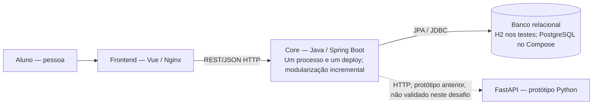
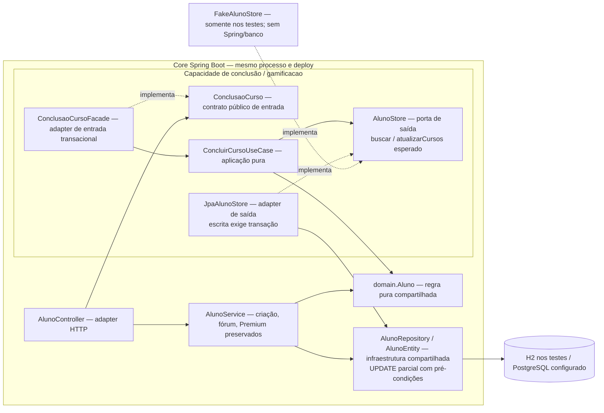
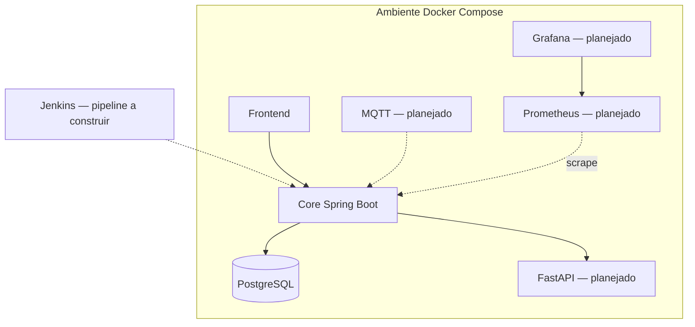

# Diagramas C4 — Architecture Lab B1

**Cuidado:** as visões abaixo descrevem a arquitetura **decidida/planejada**. O sistema atualmente entregue ainda é um MVP e não possui todos os componentes. O Core, frontend e banco existem. Os demais dependem dos laboratórios dos desafios 3–6.

## C4 Container — estado do Desafio 1

Conclusão de curso é uma capacidade interna do Core, sem deploy, rede ou banco exclusivos. A seta para FastAPI registra código herdado do pacote inicial; D1 não valida essa integração. Broker, IoT e observabilidade permanecem apenas na visão futura abaixo.

## C4 Component — Core, estado do Desafio 2

Setas contínuas representam dependências de uso; “implementa” explicita inversão de dependências. O caso de uso depende da porta; os adapters implementam a porta definida pela aplicação. O fake não é bean nem serviço/container de produção. Na composição real, `GamificacaoConfiguration` injeta `AlunoStore` no caso de uso e o Spring seleciona o adapter JPA.

A chamada pública entra pela fachada transacional; o contrato de saída atualiza somente cursos, rejeitando snapshot obsoleto. Domínio, entidade e repository seguem compartilhados com o legado, sem migração global. A mesma regra foi exercitada com os dois adapters nos [testes D2](../evidencias/desafio-2/README.md). O nível Container continua inalterado: uma aplicação Core, sem novos serviços.

## C4 Deployment — visão proposta para desafio 6

A visão Deployment acima é proposta futura e não evidencia execução dos desafios 3–6. Nos diagramas anteriores, os rótulos distinguem implementação de integração não validada; setas “implementa” representam implementação de interface, não comunicação remota.
