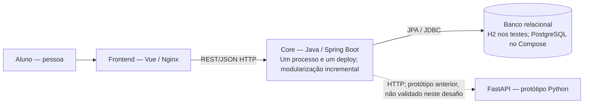
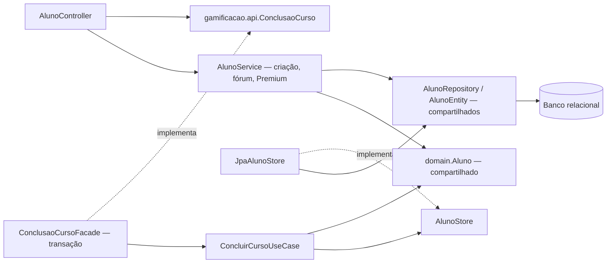
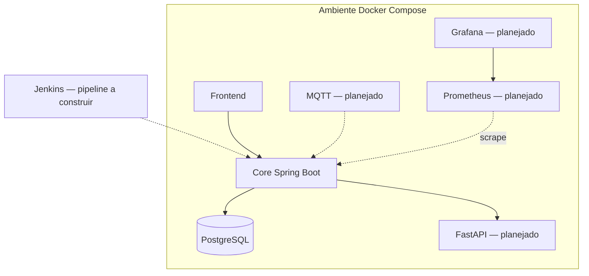

# Diagramas C4 — Architecture Lab B1

**Cuidado:** as visões abaixo descrevem a arquitetura **decidida/planejada**. O sistema atualmente entregue ainda é um MVP e não possui todos os componentes. O Core, frontend e banco existem. Os demais dependem dos laboratórios dos desafios 3–6.

## C4 Container — estado do Desafio 1

Conclusão de curso é uma capacidade interna do Core, sem deploy, rede ou banco exclusivos. A seta para FastAPI registra código herdado do pacote inicial; D1 não valida essa integração. Broker, IoT e observabilidade permanecem apenas na visão futura abaixo.

## Mapa da fatia interna — apoio à leitura do D1

Este mapa atualiza a documentação para corresponder ao código D1; o aprofundamento do C4 Component e da substituição de adapters continua no Desafio 2.

## C4 Deployment — visão proposta para desafio 6

A visão Deployment acima é proposta futura e não evidencia execução dos desafios 3–6. Nos diagramas anteriores, os rótulos distinguem implementação de integração não validada; setas “implementa” representam implementação de interface, não comunicação remota.
